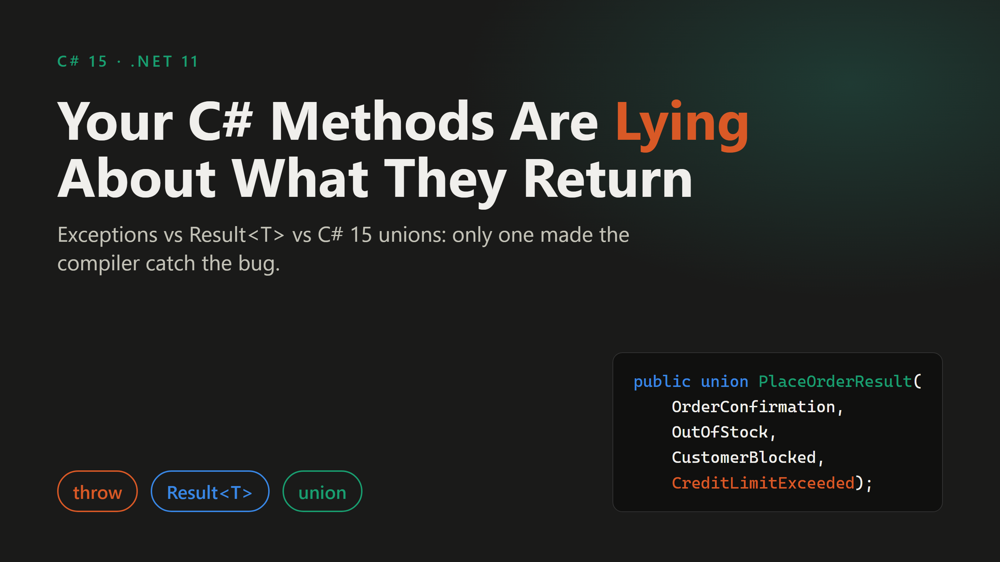
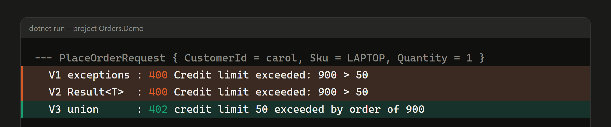
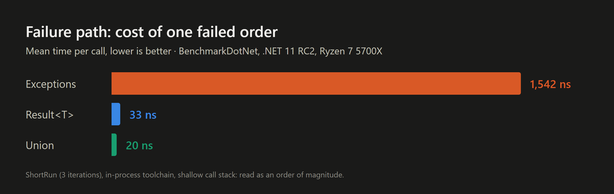

# Exception Handling in C#, Revisited



Companion repo for the article **"Your C# Methods Are Lying About What They Return"**: the same use case (`PlaceOrder`) implemented with exceptions, `Result<T>` and C# 15 unions on .NET 11.

The business rules are identical in every version:

| Folder | Approach | Failure is... |
|---|---|---|
| `Orders/V1_Exceptions` | `throw` / `catch` | invisible in the signature |
| `Orders/V2_Result` | hand-rolled `Result<T>` + open `Error` hierarchy | visible, but the set of errors is open |
| `Orders/V3_Unions` | C# 15 `union` keyword | visible **and** closed: the compiler checks exhaustiveness |
| `Orders/V3b_UnionAttribute` | hand-written `[Union]` struct | same as V3: it is what the keyword generates, written by hand |

## Run it

Requires the .NET 11 SDK (tested with `11.0.100-rc.2`). Unions are still behind `<LangVersion>preview</LangVersion>`.

```bash
dotnet run  --project Orders.Demo                 # same 6 requests through all versions
dotnet test Orders.Tests                          # 5 tests
dotnet run  --project Orders.Benchmarks -c Release
```

## What the demo shows

For a customer who tries to buy a 900 laptop with a credit limit of 50, V1 and V2 answer **400** (the catch-all swallowed a case nobody handled), while V3 answers **402**, because the compiler would not let us skip it.



## The compiler checks every case

Delete any arm of the V3 `switch` and the build reports `CS8509`, naming the missing case. `Orders.Demo.csproj` promotes it to an error.


## Benchmarks

BenchmarkDotNet 0.15.8, .NET 11.0.0-rc.2, AMD Ryzen 7 5700X, Windows 11.



| Method | Mean | Error | StdDev | Allocated |
|---|---:|---:|---:|---:|
| Exceptions, success | 85.43 ns | 1.048 ns | 0.057 ns | 72 B |
| Result, success | 95.60 ns | 17.118 ns | 0.938 ns | 104 B |
| Union (keyword), success | 86.98 ns | 21.330 ns | 1.169 ns | 96 B |
| Union (`[Union]`), success | 87.38 ns | 4.677 ns | 0.256 ns | 96 B |
| **Exceptions, failure** | **1,542.27 ns** | 910.723 ns | 49.920 ns | 384 B |
| Result, failure | 33.17 ns | 3.744 ns | 0.205 ns | 96 B |
| Union (keyword), failure | 19.93 ns | 11.201 ns | 0.614 ns | 24 B |
| Union (`[Union]`), failure | 19.55 ns | 2.502 ns | 0.137 ns | 24 B |

How to read it:

- On the success path all versions are equivalent (the differences are within the error margins).
- On the failure path, throw/catch is roughly 50 to 80 times slower than returning a value.
- The keyword and attribute union forms perform the same, which matches what reflection shows: the keyword generates a `[Union]` struct implementing `IUnion`.

Caveats: this is a `ShortRun` (3 iterations) executed **in-process**, because BenchmarkDotNet 0.15.8 does not recognise `net11.0` yet. The call stack is shallow, and exceptions get more expensive as the stack gets deeper. Treat the ratios as an order of magnitude. The raw report is in [benchmark-results.md](benchmark-results.md).
