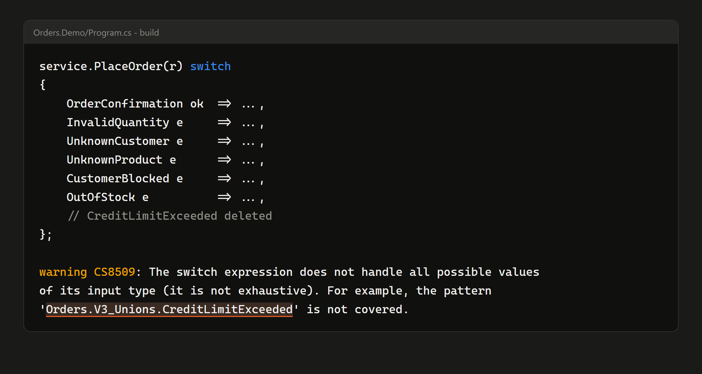

# Exception Handling in C#, Revisited


Companion repo for the article **[Your C# Methods Are Lying About What They Return](docs/article/article.md)**:
exception handling revisited for .NET 11 and C# 15 unions. It follows up on the 2024 (.NET 8) article
[Exception handling in C#](https://medium.com/@manu.dinicola/exception-handling-in-c-5f612fc52195);
see [what changed since 2024](docs/article/changes-from-2024.md).

One use case (`PlaceOrder`), the same business rules, implemented four ways on **.NET 11 / C# 15**:

| Version | Namespace (folder under `src/Orders`) | Approach | Failure is... |
|---|---|---|---|
| V1 | `Orders.Exceptions` (`Exceptions/`) | `throw` / `catch` | invisible in the signature |
| V2 | `Orders.Results` (`Results/`) | hand-rolled `Result<T>` + open `Error` hierarchy | visible, but the set of errors is open |
| V3 | `Orders.Unions` (`Unions/`) | C# 15 `union` keyword | visible **and** closed: the compiler checks exhaustiveness |
| V3b | `Orders.Unions.Handwritten` (`Unions/Handwritten/`) | hand-written `[Union]` struct | same as V3: it is what the keyword generates, written by hand |

## Repository layout

```text
.
├── src/Orders/                      the four implementations + shared domain
│   ├── Domain/                      requests, records, in-memory Store
│   ├── Exceptions/                  V1  OrderExceptions.cs, OrderService.cs
│   ├── Results/                     V2  Errors.cs, Result.cs, OrderService.cs
│   └── Unions/                      V3  Cases.cs, PlaceOrderResult.cs (union keyword), OrderService.cs
│       └── Handwritten/             V3b PlaceOrderResult.cs ([Union] struct), OrderService.cs
├── samples/
│   ├── Orders.Demo/                 console app: same 6 requests through every version
│   └── Orders.Api/                  minimal API: union → HTTP status, IExceptionHandler + ProblemDetails
├── tests/
│   ├── Orders.Tests/                business rules + union shape (xUnit v3 on Microsoft.Testing.Platform)
│   └── Orders.Api.Tests/            HTTP status per outcome, no leaks on 500
├── benchmarks/
│   ├── Orders.Benchmarks/           PlaceOrder four ways (BenchmarkDotNet 0.16)
│   └── Exceptions.Runtimes/         throw vs return by stack depth, .NET 8 vs .NET 11
├── docs/
│   ├── article/                     the article, 2024 → 2026 comparison, technical review, publishing kit
│   ├── images/                      figures used by the article
│   └── benchmarks/                  raw BenchmarkDotNet reports, one file per run
├── Directory.Build.props            net11.0, C# 15, nullable, warnings as errors (incl. CS8509)
├── Directory.Packages.props         central package versions
└── global.json                      SDK 11.0.100, MTP test runner
```

## Run it

Requires the [.NET 11 SDK](https://dotnet.microsoft.com/download/dotnet/11.0) (11.0.100 or later).
Unions ship in C# 15, the default language version for `net11.0`: no `LangVersion=preview` needed.

```bash
dotnet run   --project samples/Orders.Demo                         # same 6 requests through every version
dotnet run   --project samples/Orders.Api                          # POST /orders, GET /boom
dotnet test                                                        # 38 tests
dotnet run -c Release --project benchmarks/Orders.Benchmarks       # full run (a few minutes)
dotnet run -c Release --project benchmarks/Orders.Benchmarks -- --job short   # quick look

# .NET 8 vs .NET 11 (needs the .NET 8 runtime installed as well)
dotnet run -c Release -f net11.0 --project benchmarks/Exceptions.Runtimes -- --runtimes net8.0 net11.0
```

## What the demo shows

For a customer who tries to buy a 900 laptop with a credit limit of 50, V1 and V2 answer **400** (the
catch-all swallowed a case nobody handled), while V3 answers **402**, because the compiler would not let
us skip it.


## The compiler checks every case

Delete any arm of the V3 `switch` and the build fails with `CS8509`, naming the missing case:

```text
error CS8509: The switch expression does not handle all possible values of its input type
(it is not exhaustive). For example, the pattern 'Orders.Unions.CreditLimitExceeded' is not covered.
```

`CS8509` is normally a warning; `Directory.Build.props` makes it an error for the whole repo.



## Benchmarks

Every benchmark calls `PlaceOrder` and answers one question, *did it succeed?*, returning a `bool`, so
no row pays for boxing or string formatting that another one skips. Exceptions are the baseline of each
category, which gives the `Ratio` column.

BenchmarkDotNet 0.16.0-preview.2, .NET 11.0.0, out-of-process, default job,
Linux cloud container (Intel Xeon 2.10 GHz, 4 cores):

| Method | Category | Mean | Ratio | Allocated |
|---|---|---:|---:|---:|
| Exceptions | Success | 447.7 ns | 1.00 | 72 B |
| Result | Success | 412.4 ns | 0.92 | 72 B |
| Union (keyword) | Success | 419.7 ns | 0.94 | 72 B |
| Union (`[Union]`) | Success | 416.4 ns | 0.93 | 72 B |
| **Exceptions** | **Failure** | **1,860.3 ns** | **1.000** | **368 B** |
| Result | Failure | 38.0 ns | 0.021 | 96 B |
| Union (keyword) | Failure | 17.9 ns | 0.010 | 24 B |
| Union (`[Union]`) | Failure | 19.2 ns | 0.010 | 24 B |

How to read it:

- **Success path:** all versions are equivalent, within the error margins, and allocate the same
  72 B (the `OrderConfirmation`). On Linux the success path is dominated by `Guid.NewGuid()`.
- **Failure path:** throw/catch is roughly 50x slower than returning a `Result`, and about 100x slower
  than returning a union case.
- `Result` allocates 96 B on failure versus 24 B for a union case: the `Error` record formats its
  `Message` string eagerly, in the constructor.
- The keyword and attribute union forms perform the same, as expected:
  `tests/Orders.Tests/UnionShapeTests.cs` checks that the keyword emits a `[Union]` struct implementing `IUnion`.

### .NET 8 vs .NET 11

The cost of reporting one failure from N frames down (same code, both runtimes):

| Depth | Throw .NET 8 | Throw .NET 11 | Speed-up | Return .NET 8 | Return .NET 11 |
|---:|---:|---:|---:|---:|---:|
| 1 | 9.07 µs | 1.75 µs | 5.2x | 2.9 ns | 3.4 ns |
| 10 | 18.67 µs | 5.45 µs | 3.4x | 16.3 ns | 18.9 ns |
| 50 | 57.00 µs | 22.56 µs | 2.5x | 378.2 ns | 405.6 ns |

.NET 9's exception handling rewrite made throwing 2.5 to 5x cheaper. It is still two orders of
magnitude more expensive than returning a value.

Caveats: a shared cloud VM, so treat the ratios as an order of magnitude, not the nanoseconds.
Raw reports are in [docs/benchmarks](docs/benchmarks).
