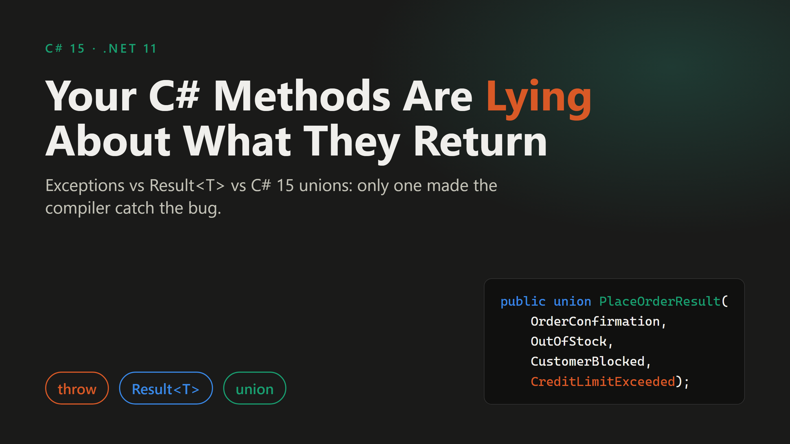
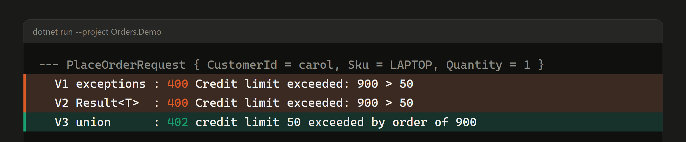

# Your C# Methods Are Lying About What They Return

*Exception handling, revisited for .NET 11: what two years, three runtimes and C# 15 unions changed.*



> **TL;DR**
> - Exceptions and `Result<T>` share a bug the compiler can't see: a new failure case slips through a catch-all.
> - C# 15 unions close the set of outcomes. Forget a case and **the build fails**.
> - Exceptions got **2.5 to 5× faster** between .NET 8 and .NET 11. They are still **~100× slower** than returning a value.
> - Keep exceptions for what nobody expected, and catch them in one place. Everything else goes in the return type.
> - All code, tests and benchmarks: [github.com/ManuDinicola/exceptions-revisited](https://github.com/ManuDinicola/exceptions-revisited)

---

## A valid order, a wrong answer

Carol has a credit limit of 50. She tries to buy a laptop that costs 900. Our API answers:

```text
400 Bad Request: Credit limit exceeded: 900 > 50
```

Her request was perfectly valid. The correct answer is **402 Payment Required**, and the client
app has a dedicated screen for it, offering to pay by card. Carol never sees that screen: the
client trusts the 400, shows "invalid request", and she leaves.

Nobody wrote a bug here, at least not on purpose. Everything compiles, every test passes, and the
code looks complete. Here it is:

```csharp
try { var ok = service.PlaceOrder(r); return $"OK {ok.Total}"; }
catch (CustomerBlockedException e) { return $"403 {e.Message}"; }
catch (OutOfStockException e)      { return $"409 {e.Message}"; }
catch (OrderException e)           { return $"400 {e.Message}"; }   // catch-all base class
```

The credit-limit rule was added six months after this caller was written.
`CreditLimitExceededException` derives from `OrderException`, so the last `catch` absorbed it.
No warning, no failing test, just a wrong status code in production.

This article is about why that happens, why the fix I recommended in 2024 doesn't prevent it,
and how C# 15 finally does.

## The signature is the lie

Look at what `PlaceOrder` promises:

```csharp
// The signature says "I return a confirmation".
// It does NOT say "I can throw six different things".
public OrderConfirmation PlaceOrder(PlaceOrderRequest request)
{
    if (request.Quantity <= 0) throw new InvalidQuantityException(request.Quantity);

    var customer = store.FindCustomer(request.CustomerId)
        ?? throw new UnknownCustomerException(request.CustomerId);
    if (customer.IsBlocked) throw new CustomerBlockedException(customer.Id);
    // ... out of stock, credit limit ...
    return new OrderConfirmation(Guid.NewGuid(), customer.Id, product.Sku, request.Quantity, total);
}
```

It returns an `OrderConfirmation`. It actually has **seven** possible outcomes: one success and six
business refusals (invalid quantity, unknown customer, unknown product, blocked customer, out of
stock, credit limit). None of them is exceptional. They happen every day, and each one deserves a
different answer.

C# has no checked exceptions, so the only way to know what to catch is to read the implementation,
and to read it again every time it changes. That is the lie: **the type says one thing, the
behaviour says seven.**

## The fix I recommended in 2024, and why it isn't enough

Two years ago, in [Exception Handling in C#](https://medium.com/@manu.dinicola/exception-handling-in-c-5f612fc52195),
I recommended `Result<T>`. Here is an improved version, with typed errors instead of the string I
used back then:

```csharp
public abstract record Error(string Message);
public sealed record CustomerBlocked(string Id) : Error($"Customer blocked: {Id}");
public sealed record CreditLimitExceeded(decimal Total, decimal Limit)
    : Error($"Credit limit exceeded: {Total} > {Limit}");
// ...

public Result<OrderConfirmation> PlaceOrder(PlaceOrderRequest request)
{
    if (customer.IsBlocked) return new CustomerBlocked(customer.Id);
    // ...
}
```

Better: the signature now admits that something can fail. Now look at the caller:

```csharp
err switch
{
    CustomerBlocked => $"403 {err.Message}",
    OutOfStock      => $"409 {err.Message}",
    _               => $"400 {err.Message}",   // required, because Error is an OPEN hierarchy
}
```

`Error` is an abstract record, so anyone, anywhere, can derive from it. The compiler cannot prove
this switch is complete, so it **forces** a discard arm `_`. That arm swallows
`CreditLimitExceeded` exactly like the catch-all did.

**Same bug. Same 400. Carol still leaves.**

`Result<T>` made failure *visible*. What we need is failure that is *closed*: a fixed, known list
of outcomes the compiler can check.

## C# 15 unions: the compiler holds the list

C# 15 ships with .NET 11, and it adds the `union` declaration:

```csharp
public sealed record InvalidQuantity(int Quantity);
public sealed record UnknownCustomer(string Id);
public sealed record UnknownProduct(string Sku);
public sealed record CustomerBlocked(string Id);
public sealed record OutOfStock(string Sku, int Requested, int Available);
public sealed record CreditLimitExceeded(decimal Total, decimal Limit);

public union PlaceOrderResult(
    OrderConfirmation,
    InvalidQuantity,
    UnknownCustomer,
    UnknownProduct,
    CustomerBlocked,
    OutOfStock,
    CreditLimitExceeded);
```

Read it out loud: *placing an order results in a confirmation, or one of these six refusals.* That
is the whole contract, in the type. The cases are plain records, with no base class and no
`Message` property.

The method body barely changes, because each case converts implicitly to the union:

```csharp
public PlaceOrderResult PlaceOrder(PlaceOrderRequest request)
{
    if (request.Quantity <= 0) return new InvalidQuantity(request.Quantity);
    // ...
    return new OrderConfirmation(Guid.NewGuid(), customer.Id, product.Sku, request.Quantity, total);
}
```

The difference shows in the caller, here an ASP.NET Core endpoint:

```csharp
public static IResult ToHttpResult(PlaceOrderResult result) => result switch
{
    OrderConfirmation ok  => TypedResults.Ok(ok),
    InvalidQuantity e     => Problem(400, "Invalid quantity", $"Quantity must be positive, got {e.Quantity}."),
    UnknownCustomer e     => Problem(404, "Unknown customer", $"Customer '{e.Id}' does not exist."),
    UnknownProduct e      => Problem(404, "Unknown product", $"Product '{e.Sku}' does not exist."),
    CustomerBlocked e     => Problem(403, "Customer blocked", $"Customer '{e.Id}' is blocked."),
    OutOfStock e          => Problem(409, "Out of stock", $"{e.Requested} x {e.Sku} requested, {e.Available} available."),
    CreditLimitExceeded e => Problem(402, "Credit limit exceeded", $"Order total {e.Total} exceeds the limit of {e.Limit}."),
};
```

There is no discard arm. Delete any arm, or add an eighth case to the union six months from now,
and the compiler reports:

```text
warning CS8509: The switch expression does not handle all possible values of its input type
(it is not exhaustive). For example, the pattern 'Orders.Unions.CreditLimitExceeded' is not covered.
```

It names the missing case. One line in `Directory.Build.props` turns that warning into a build
failure for the whole solution:

```xml
<WarningsAsErrors>$(WarningsAsErrors);CS8509</WarningsAsErrors>
```

From then on, the developer who adds the credit-limit rule *cannot* ship until every caller decides
what to do with it. Carol gets her 402.



### What the keyword compiles to

`union` is not magic. The compiler emits a struct marked with
`System.Runtime.CompilerServices.UnionAttribute` that implements `IUnion`, with one constructor per
case and an `object? Value` property. You can write it yourself, and pattern matching and
exhaustiveness work identically:

```csharp
[Union]
public readonly struct PlaceOrderResult : IUnion
{
    public PlaceOrderResult(OrderConfirmation value) => Value = value;
    public PlaceOrderResult(InvalidQuantity value) => Value = value;
    // ... one constructor per case ...
    public object? Value { get; }
}
```

The hand-written form is useful when the union needs extra members. For everything else, use the keyword.

## Three traps I hit on the way

**1. Only switch *expressions* are checked.** A `switch` *statement* over a union that handles two
of seven cases compiles **with no diagnostic at all**. I got this wrong in my
[October article on unions](https://medium.com/@manu.dinicola/why-union-types-might-be-the-most-important-c-15-feature-972d54d05604),
whose exhaustiveness examples use statements. If you want the guarantee, write `result switch { ... }`.

**2. `default` is a hidden eighth case.** `default(PlaceOrderResult)` has `Value == null`, matches
no arm, and the switch throws `SwitchExpressionException` at run time. The compiler warns (CS8655)
only when it can see the `default` locally, not across a method boundary. Be careful with
uninitialised fields and arrays of unions.

**3. Don't put the unexpected in the union.** A `DatabaseUnavailable` case forces every caller, at
every level, to handle something none of them can fix. That is exactly what exceptions are for.

## Exceptions aren't dead. They're specialised.

The rule that comes out of all this:

> **Expected outcomes belong in the return type. Exceptions are for the unexpected.**

*Expected* means the caller must decide: blocked customer, empty stock, a user typing "abc" in a
number field. *Unexpected* means nobody nearby can fix it: the database is down, a configuration
value is missing, a bug produced a `null`. Exceptions remain the right tool for the second kind,
and a few habits make them work well.

**Guard clauses are built in.** Passing `null` is a programming error, not a business outcome, so
throwing is correct. .NET ships the helpers:

```csharp
ArgumentNullException.ThrowIfNull(request);
ArgumentException.ThrowIfNullOrWhiteSpace(request.CustomerId);
ArgumentOutOfRangeException.ThrowIfNegativeOrZero(request.Quantity);
```

**Catch narrowly, filter, rethrow properly:**

```csharp
try
{
    order = service.PlaceOrder(request);
}
catch (OutOfStockException e) when (e.Available > 0)   // a filter: only catch what you can handle
{
    order = service.PlaceOrder(request with { Quantity = e.Available });
}
catch (HttpRequestException e)
{
    // Add context, keep the original as InnerException.
    throw new InventoryUnavailableException("Inventory service unreachable.", e);
}
```

- Catch specific types, and only where you can act.
- Use filters (`when`): a filter that returns `false` doesn't unwind the stack, so crash dumps keep
  the original throw site.
- Rethrow with `throw;`, never `throw ex;`, which resets the stack trace.
- Wrap with context and keep the cause as the inner exception.

**Custom exceptions:** seal them, expose their data as properties so nobody parses `Message`, and drop
`[Serializable]` and the serialization constructor, obsolete since .NET 8 (SYSLIB0051):

```csharp
public sealed class InventoryUnavailableException : Exception
{
    public InventoryUnavailableException() { }
    public InventoryUnavailableException(string message) : base(message) { }
    public InventoryUnavailableException(string message, Exception innerException)
        : base(message, innerException) { }
}
```

If you are about to write `CustomerBlockedException`, stop. That is a union case waiting to happen.

## One place for the unexpected

Unexpected exceptions should travel up to **one** place that logs them and answers "something went
wrong", without telling the client anything an attacker could use. In ASP.NET Core on .NET 11,
that place is `IExceptionHandler` plus ProblemDetails:

```csharp
internal sealed partial class UnexpectedExceptionHandler(
    IProblemDetailsService problemDetails,
    IHostEnvironment environment,
    ILogger<UnexpectedExceptionHandler> logger) : IExceptionHandler
{
    public async ValueTask<bool> TryHandleAsync(
        HttpContext httpContext, Exception exception, CancellationToken cancellationToken)
    {
        LogUnhandled(logger, httpContext.Request.Method, httpContext.Request.Path, exception);

        httpContext.Response.StatusCode = StatusCodes.Status500InternalServerError;

        var problem = new ProblemDetails
        {
            Status = StatusCodes.Status500InternalServerError,
            Title = "An unexpected error occurred.",
        };

        if (environment.IsDevelopment())
        {
            problem.Detail = exception.ToString();   // never outside Development
        }

        return await problemDetails.TryWriteAsync(new ProblemDetailsContext
        {
            HttpContext = httpContext,
            ProblemDetails = problem,
            Exception = exception,
        });
    }

    [LoggerMessage(Level = LogLevel.Error, Message = "Unhandled exception on {Method} {Path}")]
    private static partial void LogUnhandled(ILogger logger, string method, string path, Exception exception);
}
```

```csharp
builder.Services.AddProblemDetails();
builder.Services.AddExceptionHandler<UnexpectedExceptionHandler>();

var app = builder.Build();
app.UseExceptionHandler();
app.UseStatusCodePages();
```

It logs **once**: since ASP.NET Core 10, the middleware no longer records its own diagnostics
for exceptions that a handler reports as handled. You can change this with
`ExceptionHandlerOptions.SuppressDiagnosticsCallback`. The repo has an integration test for both
properties: a crashing endpoint returns a 500 ProblemDetails with no secret in the body, and
produces exactly one error log entry.

This handler is a safety net. If it ever contains `if (exception is CustomerBlockedException) return 403`,
it is doing the job of a return type.

## What I got wrong in 2024

If you read the original article, here are the corrections, in one place:

- **"Managed vs unhandled exceptions."** Every C# exception is a managed exception, so the split
  was meaningless. The useful split is expected vs unexpected.
- **`catch (Exception ex)` as the template.** It is exactly the catch-all that hid Carol's 402.
- **Two of my three ASP.NET Core snippets were unsafe.** One returned 400 for server crashes, one
  sent the stack trace to the client, and the `IExceptionHandler` one copied every request header,
  tokens and cookies included, into responses outside production.
- **The log-suppression workaround** (in `appsettings.json` or Serilog) is unnecessary since ASP.NET Core 10.
- **My benchmark mixed success and failure** in one loop, used a class-based `Result` that allocated
  on both paths, and enabled a Windows-only profiler. The numbers below fix all of that.
- **"Limit exceptions because they are slow."** Still true, but it is the weaker argument. The
  stronger one is that a signature should tell the truth.

## The numbers: what .NET 8 → .NET 11 changed

Here is the surprise: exceptions got **much** faster. .NET 9 rewrote the runtime's
exception handling, and the same throw/catch code runs 2.5 to 5× faster on .NET 11 than on .NET 8.
The benchmark reports one failure from N stack frames down, by throwing or by returning:

```text
Depth   Throw .NET 8   Throw .NET 11   speed-up   Return .NET 8   Return .NET 11
-----   ------------   -------------   --------   -------------   --------------
    1       9.07 µs         1.75 µs       5.2x          2.9 ns           3.4 ns
   10      18.67 µs         5.45 µs       3.4x         16.3 ns          18.9 ns
   50      57.00 µs        22.56 µs       2.5x        378.2 ns         405.6 ns
```

The gap is still two orders of magnitude. On .NET 11, one failure one frame down costs about
1.7 µs when thrown and about 3 ns when returned, and every extra frame adds about 0.4 µs to a
throw. Returning didn't need a rewrite: it was already almost free.

On the real `PlaceOrder`, on .NET 11:

```text
Method                  Mean        Ratio   Allocated
----------------------  ----------  ------  ---------
Success path
  Exceptions              447.7 ns    1.00       72 B
  Result<T>               412.4 ns    0.92       72 B
  union (keyword)         419.7 ns    0.94       72 B
  [Union] (hand-written)  416.4 ns    0.93       72 B
Failure path
  Exceptions            1,860.3 ns   1.000      368 B
  Result<T>                38.0 ns   0.021       96 B
  union (keyword)          17.9 ns   0.010       24 B
  [Union] (hand-written)   19.2 ns   0.010       24 B
```

- **When things go well, it's a tie.** Returning a union costs nothing extra.
- **When things fail, throwing costs about 49× more than a `Result` and about 100× more than a union.**
  That matters wherever failure is a normal path: login forms, checkouts, validation endpoints.
- `Result` allocates 4× more than a union on failure. This isn't `Result<T>` itself: the
  `Error` base record builds its `Message` string eagerly, even if nobody reads it.

*BenchmarkDotNet 0.16.0-preview.2, default job, .NET 8.0.34 and 11.0.0, 4-core Linux cloud VM. Read
the ratios, not the nanoseconds; on Linux the success path is dominated by `Guid.NewGuid()`. Raw reports
are in the repo.*

## The cheat sheet

```text
Is this outcome part of the business contract (the caller must decide)?
├── Yes → return it.
│         ├── Closed, known set of outcomes   → C# 15 union + switch expression + CS8509 as error
│         ├── Just "found / not found"        → Try pattern (bool + out) or nullable
│         └── Open set, plugins, extensibility → Result<T> with typed errors (accept the discard arm)
└── No, it's a bug or the environment failing → throw.
          ├── Guard clauses: ArgumentNullException.ThrowIfNull & co.
          ├── Catch only where you can act; use `when`; rethrow with `throw;`
          └── One IExceptionHandler at the edge: log once, 500 + ProblemDetails, no leaks
```

## Try it yourself

The companion repo has the four versions side by side (exceptions, `Result<T>`, union keyword,
hand-written `[Union]`), a console demo, a minimal API, 38 tests and both benchmarks:

```bash
git clone https://github.com/ManuDinicola/exceptions-revisited
cd exceptions-revisited
dotnet run --project samples/Orders.Demo
```

Then open `samples/Orders.Demo/Program.cs`, delete the `CreditLimitExceeded` arm from the union
switch, and run `dotnet build`. That build error is the whole article in one line.

---

**Your turn.** How does your team decide between throwing and returning today? And would you let a
compiler error block a merge for a missing business case? Tell me in the comments. I read all of them.

*.NET 11 (SDK 11.0.100) · C# 15 · BenchmarkDotNet 0.16.0-preview.2*
